

# 🏁 PitWall CAN

**Laboratorio de telemetría y ciberseguridad CAN para un monoplaza eléctrico de competición universitaria**

*Proyecto personal de aprendizaje de un estudiante de Ingeniería Informática*

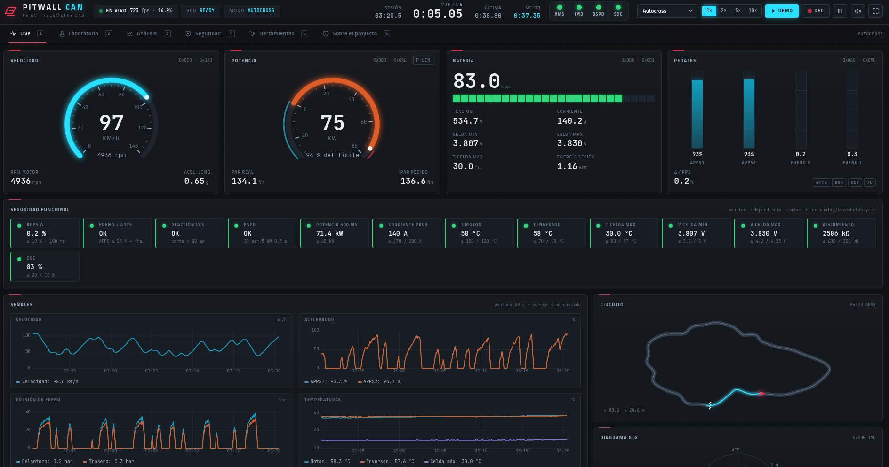

[🏗️ Arquitectura](docs/arquitectura.md) · [🔌 Protocolos](docs/protocolos.md) · [🚌 Bus CAN](docs/bus-can.md) · [🛡️ Seguridad funcional](docs/seguridad-funcional.md) · [🔐 Ciberseguridad](docs/ciberseguridad.md) · [🛠️ Cómo lo desarrollé](docs/desarrollo.md)

> [!NOTE]
> **Este repositorio es un escaparate del diseño, no el código completo.** Documenta la arquitectura, los protocolos, las decisiones
> y el proceso de desarrollo y pruebas. Es un **simulador de aprendizaje**: todos los datos son sintéticos, no se ha probado en un vehículo real
> y no está relacionado con ningún equipo ni organización.

---

## 🎯 Qué es

Una aplicación web **local** que simula el bus CAN de un coche eléctrico de competición y lo muestra en un dashboard en tiempo real.
Además importa logs y DBC en formatos estándar del sector, comprueba la plausibilidad de los sensores, analiza vueltas y
tiene un **laboratorio de ciberseguridad CAN** con un IDS medido contra ataques simulados.

La hice para **aprender** cómo funciona el software de un coche así: CAN, DBC, seguridad funcional, telemetría y ciberseguridad.
No tenía experiencia previa en automoción, así que cada parte va acompañada de documentación que explica el concepto desde cero.

## ✨ Qué hace, pestaña por pestaña

| Pestaña | Qué hace | Captura |
|---|---|---|
| **Live** | Gauges de velocidad y potencia, batería, pedales, 6 gráficas en directo, mapa del circuito por GNSS, diagrama g-g, mapa de calor de 48 celdas, ruedas, estado del shutdown circuit y alertas |  |
| **Laboratorio** | Cargar un DBC externo y validarlo; importar logs (candump, Vector ASC/BLF, PEAK TRC, CSV); decodificar, exportar, reproducir, detectar vueltas, comparar sesiones A/B y pasar el IDS por el log | 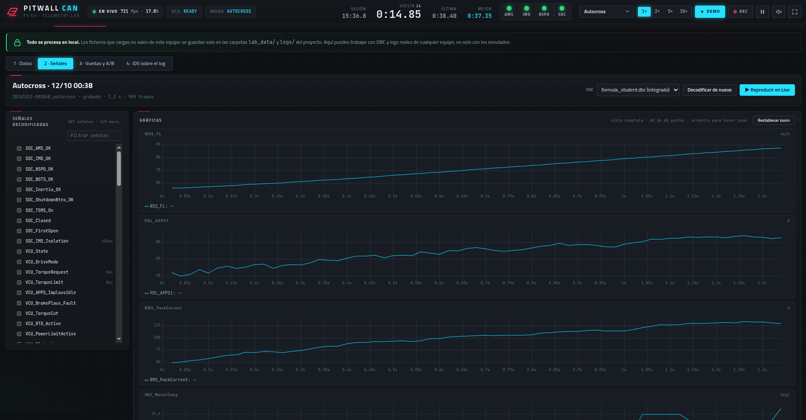 |
| **Análisis** | Sesiones grabadas: vueltas por GNSS, delta de tiempo, conclusiones automáticas, puntuación del piloto e informe HTML | 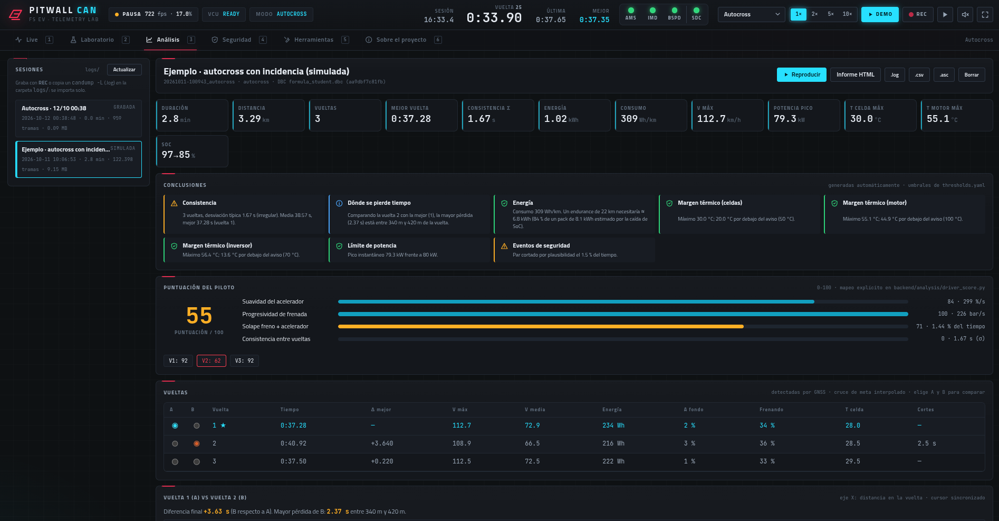 |
| **Seguridad** | Ataques etiquetados en un bus virtual, IDS de 5 detectores, métricas (TP, FP, recall, tiempo de detección) y demo de autenticación de mensajes (SecOC) | 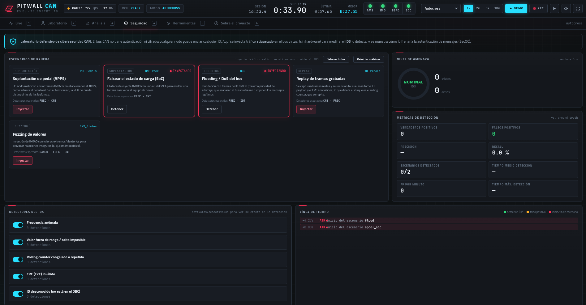 |
| **Herramientas** | Inyección de fallos, sniffer CAN, validador de DBC, estimador de autonomía y checklist pre-salida | 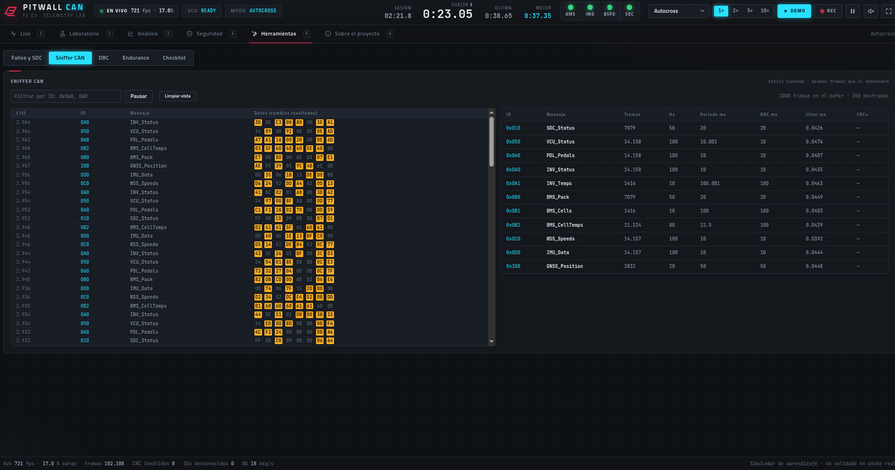 |
| **Sobre el proyecto** | Arquitectura y tabla de mensajes generada desde el propio DBC | 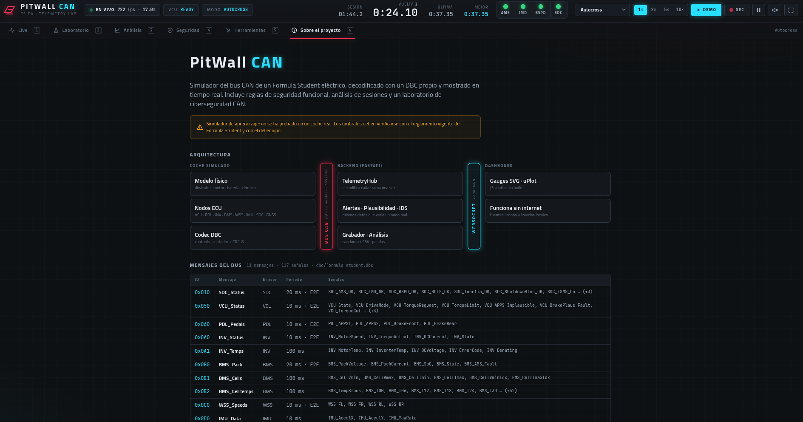 |

## 🏗️ Arquitectura en un vistazo

La idea central: **todos los módulos se comunican solo a través del bus CAN**, como los nodos de un coche real.
El IDS ve exactamente lo que vería un nodo, y cambiar el bus virtual por un adaptador físico es cambiar una línea de configuración.

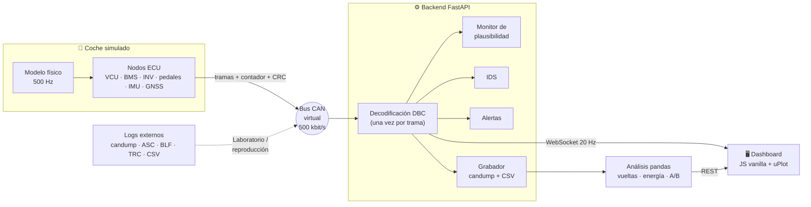

Detalle de capas, módulos y flujos: [**docs/arquitectura.md**](docs/arquitectura.md).

## 🧰 Tecnologías

| Capa | Tecnología | Para qué |
|---|---|---|
| Bus CAN | python-can (interfaz virtual) | Bus en memoria que funciona igual en Windows, Linux y macOS |
| Base de datos CAN | cantools | Codificar y decodificar tramas con un DBC |
| Backend | FastAPI + Uvicorn | REST para acciones y WebSocket para el directo |
| Datos | pandas + NumPy | Vueltas, energía, comparación de sesiones |
| Configuración | YAML | Umbrales editables con validación y recarga en caliente |
| Frontend | JavaScript sin framework + uPlot | Sin compilación ni dependencias externas; gráficas rápidas |
| Pruebas | pytest + Playwright | Tests unitarios y de integración, y pruebas de navegador |

Todo funciona **sin internet**: fuentes, iconos y librerías se sirven en local, sin CDN. Licencias de terceros: [CREDITOS.md](CREDITOS.md).

## 🔌 Protocolos y formatos

| | Usado en el proyecto | Solo contexto |
|---|---|---|
| **Red** | CAN 2.0A/B (IDs de 11 y 29 bits) | CAN FD (se detecta y se cuenta), LIN, J1939, Ethernet automotriz |
| **Datos** | DBC (también KCD, SYM, ARXML), protección E2E (contador + CRC-8) | UDS, XCP |
| **Seguridad** | SecOC simplificado (MAC truncado + frescura) | — |
| **Aplicación** | WebSocket (20 Hz), REST/JSON | — |
| **Logs** | candump (`-l`, `-L`, consola), Vector ASC, Vector BLF, PEAK TRC, CSV | — |

Explicación de cada uno, con ejemplos: [**docs/protocolos.md**](docs/protocolos.md) · Mensajes del bus y decodificación a mano: [**docs/bus-can.md**](docs/bus-can.md).

## 🧪 Laboratorio: trabajar con datos externos

> 🔒 **Todo se procesa en local.** Los ficheros importados no salen del equipo.

| | |
|---|---|
| 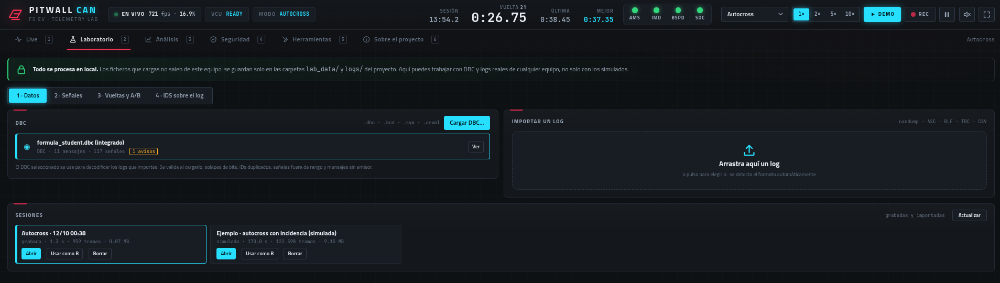 |  |
| **Datos:** cargar un DBC, arrastrar un log y ver las sesiones. | **Señales:** señales decodificadas y gráficas con zoom. |
| 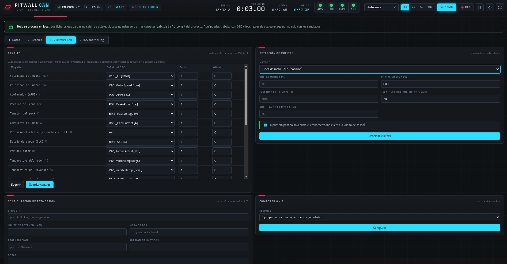 | 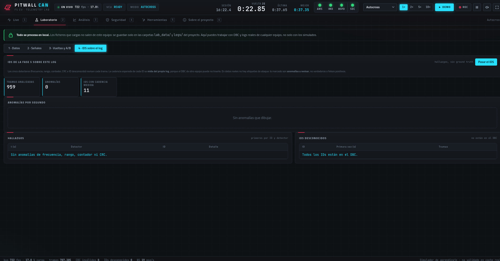 |
| **Vueltas y A/B:** mapeo de canales con conversión de unidades, detección de vueltas y comparador. | **IDS sobre el log:** hallazgos e IDs que no están en el DBC. |

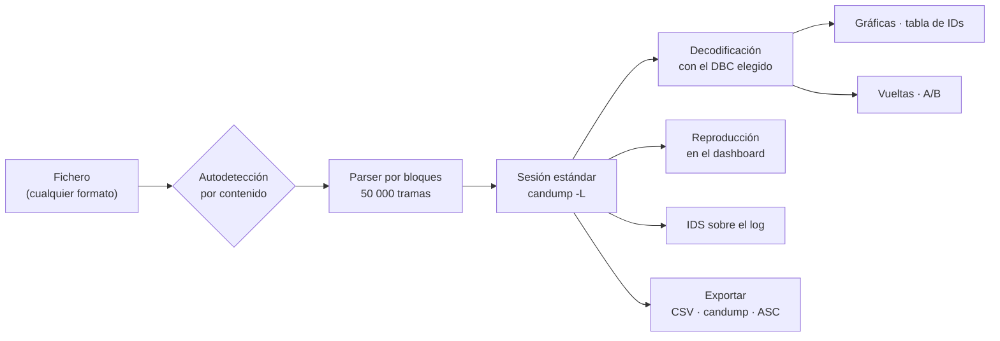

Decisión clave: **cada log importado se convierte al mismo formato de sesión** que las grabaciones propias, así que reproducción,
exportación y análisis usan un único camino de código. Las líneas corruptas se cuentan y se informan; nunca abortan la importación.

## 🛡️ Seguridad funcional y 🔐 ciberseguridad

<table>
<tr>
<td width="50%" valign="top">

**Defensa en profundidad** (simulada)

1. **VCU (software):** plausibilidad de los dos sensores del acelerador y de freno + acelerador.
2. **Monitor independiente:** recalcula todo solo con datos del bus y comprueba que la VCU reaccionó.
3. **Hardware (AMS, IMD, BSPD):** abre el shutdown circuit aunque falle el software.

Umbrales en un fichero de configuración, **orientativos**: hay que verificarlos con el reglamento oficial vigente.
→ [docs/seguridad-funcional.md](docs/seguridad-funcional.md)

</td>
<td width="50%" valign="top">

**CAN no autentica ni cifra.** El laboratorio es **defensivo**: inyecta tráfico etiquetado en un bus virtual para medir el IDS.

- 5 detectores explicables: frecuencia, rango/salto imposible, rolling counter, CRC, ID desconocido.
- **0 falsos positivos en 860 972 tramas simuladas**; los 5 escenarios detectados.
- Mitigación: SecOC con MAC truncado y contador de frescura.

→ [docs/ciberseguridad.md](docs/ciberseguridad.md)

</td>
</tr>
</table>

## 🛠️ Cómo lo desarrollé

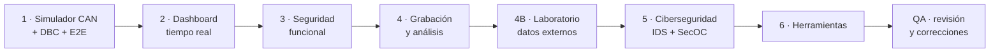

- **Fase a fase**: cada fase se ejecutaba, se probaba y se documentaba antes de pasar a la siguiente.
- **Medir en vez de asumir**: el IDS se evalúa contra tráfico etiquetado, y el simulador contra tiempos y límites físicos esperados.
- **Revisión de QA final**: inventario de cada botón y endpoint, pruebas por API y con navegador automatizado, 17 hallazgos documentados y 11 corregidos.
- **Asistencia de IA**: lo desarrollé con ayuda de herramientas de IA para generar código, revisar y documentar. El diseño, las decisiones y la verificación son míos.

Proceso completo, decisiones de diseño y lecciones aprendidas: [**docs/desarrollo.md**](docs/desarrollo.md).

## 📸 Capturas

Ver las 10 capturas (Live → Laboratorio → Análisis → Seguridad → Herramientas → Sobre el proyecto)

| | |
|---|---|
|  | 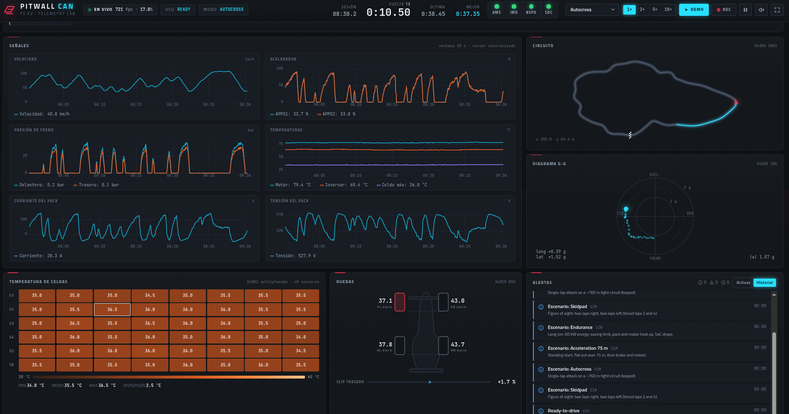 |
| **Live:** gauges, batería, pedales y franja de seguridad funcional. | **Live (abajo):** gráficas, circuito GNSS, diagrama g-g, celdas, ruedas y alertas. |
|  |  |
| **Laboratorio · Datos:** procesamiento local, DBC, importación y sesiones. | **Laboratorio · Señales:** señales decodificadas y gráficas con zoom. |
|  |  |
| **Laboratorio · Vueltas y A/B:** canales, parámetros de vuelta y comparador. | **Laboratorio · IDS sobre el log:** anomalías e IDs desconocidos. |
|  |  |
| **Análisis:** indicadores, conclusiones automáticas, piloto y vueltas. | **Seguridad:** escenarios, nivel de amenaza, métricas y detectores. |
|  |  |
| **Herramientas · Sniffer CAN:** bytes que cambian; frecuencia y jitter por ID. | **Sobre el proyecto:** arquitectura y mensajes del bus. |

## ⚠️ Limitaciones honestas

- **Simulador de aprendizaje** con datos sintéticos: no probado en un vehículo ni con hardware CAN.
- **Umbrales orientativos**: no son una cita del reglamento de ninguna competición.
- **No es tiempo real duro**: Python sirve para prototipar la lógica; un sistema real necesita C/C++ en un microcontrolador.
- El riesgo real de un ciberataque en un coche de este tipo es bajo; el laboratorio sirve para practicar buenas prácticas.

## 📄 Licencia, avisos y créditos

- **Documentación e imágenes:** [CC BY 4.0](LICENSE-docs.md). **Fragmentos de código de la documentación:** [MIT](LICENSE).
- **Sin afiliación:** proyecto personal, no relacionado con ninguna competición, organización, equipo ni fabricante.
  Las marcas citadas (p. ej. Vector, PEAK-System, AUTOSAR, STM32) pertenecen a sus titulares y se mencionan solo para identificar formatos y tecnologías.
- **Créditos de terceros** y sus licencias: [CREDITOS.md](CREDITOS.md).
- Desarrollado **con asistencia de herramientas de IA**.
