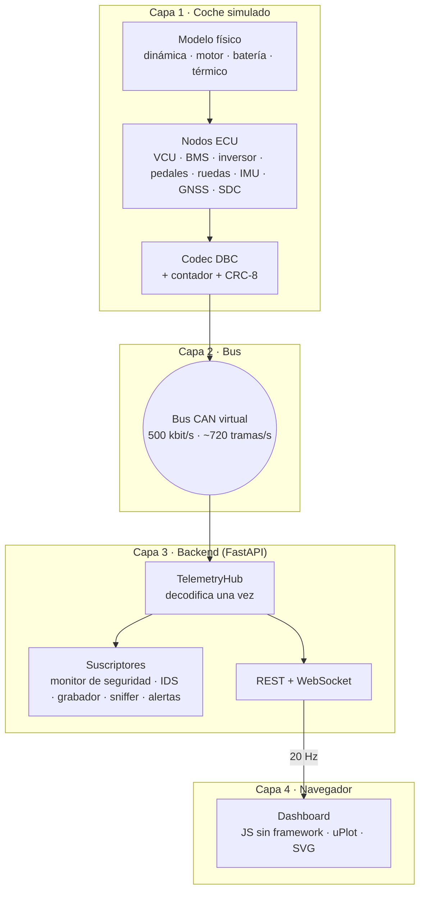
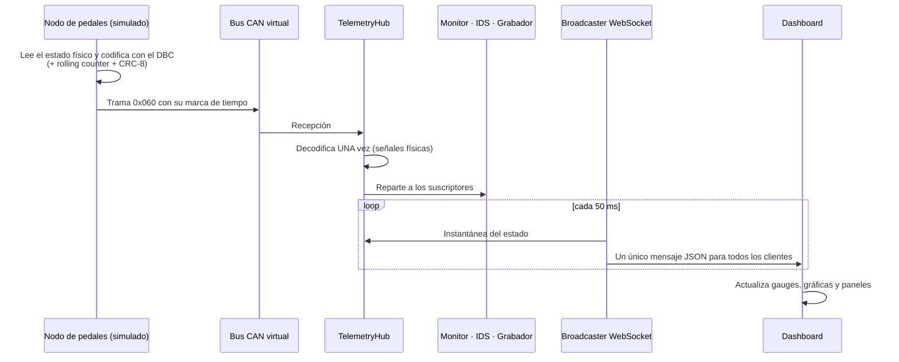
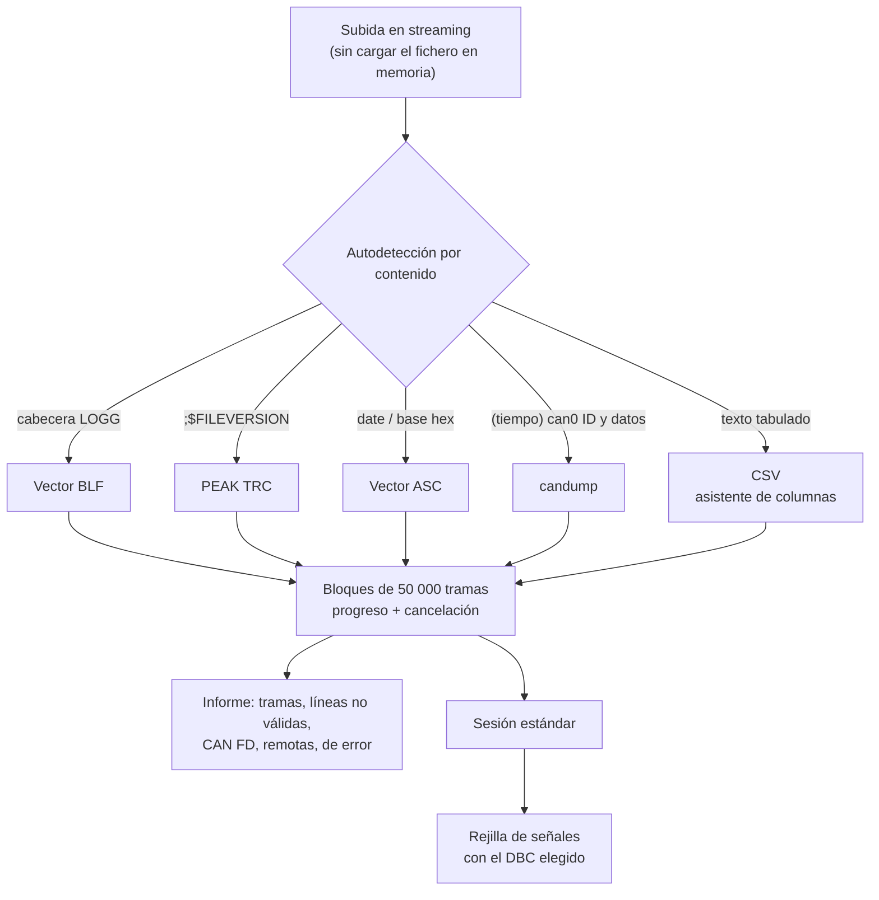
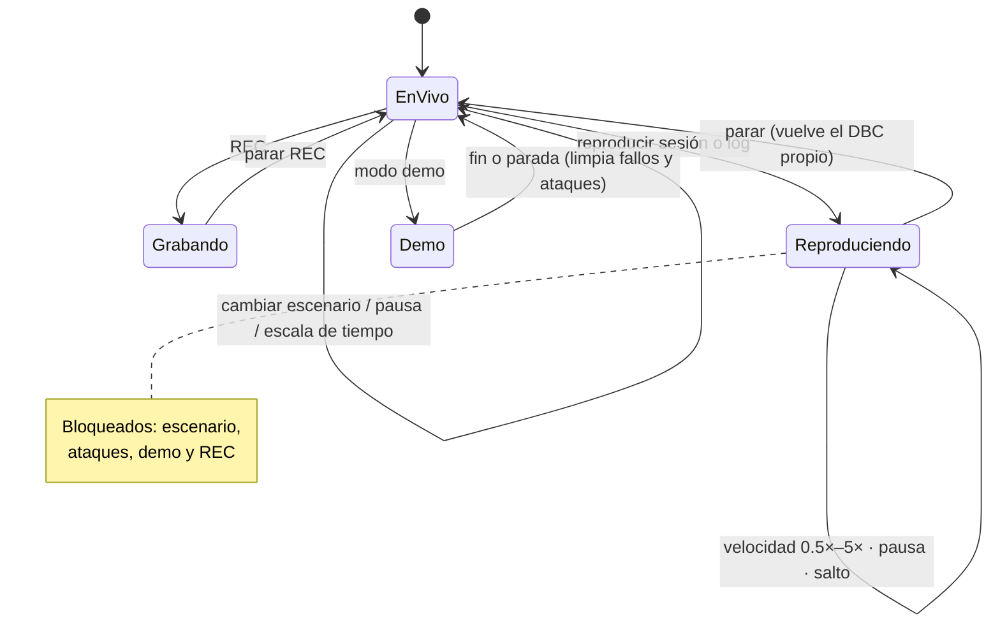

# 🏗️ Arquitectura

[← Volver al README](../README.md)

## Principio de diseño

> **Todo se comunica solo a través del bus CAN.**

El simulador, el IDS, el grabador y el dashboard **no se llaman entre sí**: cada uno es un nodo que envía o escucha tramas.

- El IDS ve exactamente lo que vería un nodo real del coche.
- Las pruebas son realistas: un fallo inyectado viaja por el bus igual que en el coche.
- Cambiar el bus virtual por un adaptador CAN físico (SocketCAN, PCAN…) es un cambio de configuración, no de arquitectura.

## Vista por capas

## Flujo de una trama

**Por qué así:** el bus genera ~720 tramas por segundo, y el navegador no necesita tantas. El backend las resume en **20 mensajes por segundo**,
serializados una sola vez y enviados a todos los clientes conectados.

## Módulos del backend (descripción funcional)

| Módulo | Responsabilidad | Decisión de diseño |
|---|---|---|
| **Simulador** | Pista, batería (circuito equivalente + térmico por grupos de celdas), vehículo, piloto, VCU con máquina de estados, escenarios y fallos | Un único estado físico coherente: velocidad de rueda, rpm, corriente y tensión cuadran entre sí |
| **Motor de simulación** | Avanza la física a 500 Hz en **tiempo simulado** y devuelve las tramas que tocan | Reloj de pasos enteros: determinista, sin deriva, y los tests corren más rápido que el tiempo real |
| **Codec DBC** | Codifica y decodifica; satura valores fuera de rango; añade contador y CRC | Una ECU recorta, no desborda; una trama mala nunca tumba el pipeline |
| **Validador DBC** | Solapes de bits (Intel y Motorola, con multiplexación), IDs duplicados, rangos no representables, mensajes sin emisor | Lo que debería cazar una revisión antes de llegar al coche |
| **TelemetryHub** | Único punto de decodificación; carga del bus (con bit stuffing), timeouts, cronómetro de vuelta | Todos los consumidores ven exactamente lo mismo |
| **Plausibilidad** | Máquinas de estado puras dirigidas por marcas de tiempo | El mismo código sirve a la VCU simulada (500 Hz) y al monitor (100 Hz) |
| **Monitor de seguridad** | Recalcula la plausibilidad solo con el bus y verifica que la VCU reaccionó | Verificación independiente, como un segundo microcontrolador |
| **Alertas** | Debounce temporal, histéresis, historial y severidad | Evita parpadeos y avisos falsos |
| **Grabación y reproducción** | Sesiones en formato `candump -L` + CSV de señales; reproducción con los tiempos originales | Formato estándar: un log del simulador y uno real son intercambiables |
| **Análisis** | Vueltas por GNSS con cruce de meta interpolado, comparación sobre distancia, energía, autonomía, puntuación del piloto, informe HTML | pandas sobre una rejilla de señales a 50 Hz |
| **Laboratorio** | Parsers por bloques con autodetección, biblioteca de DBC, importación en segundo plano, mapeo de canales, A/B, IDS sobre logs | Cualquier log se convierte a una sesión estándar: un solo camino de código |
| **Security Lab** | IDS de 5 detectores, escenarios etiquetados, métricas contra *ground truth*, demo SecOC | Reglas explicables; se mide, no se asume |
| **Herramientas** | Sniffer, checklist pre-salida, modo demo guiado | Utilidades del día a día de un equipo |

## Laboratorio: canal de importación

- **Memoria constante:** se lee por bloques, así que un log grande no carga todo en RAM (probado con 2 millones de tramas).
- **Tolerante a errores:** una línea corrupta se cuenta y se informa, nunca aborta la importación.
- **Mapeo de canales:** cada equipo llama distinto a sus señales. Se asigna qué señal es la velocidad, el acelerador, la corriente…
  con factor y offset para convertir unidades (m/s → km/h, g → m/s²) y proyección de latitud/longitud a metros.

## Estados de la fuente de datos

## Frontend

- **Sin framework ni compilación:** módulos ES nativos, servidos en local junto con las fuentes y uPlot.
- **Bucle de animación** a la frecuencia de la pantalla: los gauges se suavizan con un filtro exponencial sobre datos que llegan a 20 Hz.
- El DOM solo se toca cuando cambia un texto, para no saturar el navegador.
- Reconexión automática del WebSocket con espera exponencial.
- Atajos de teclado: `1`–`6` pestañas, `Espacio` pausa, `F` modo boxes, `R` grabar, `D` demo.

## Formato de una sesión

| Fichero | Formato | Para qué |
|---|---|---|
| `session.log` | `candump -L` | Tramas crudas sin pérdida; legible por can-utils, python-can, Wireshark o SavvyCAN |
| `signals.csv` | CSV ancho a 50 Hz | Señales decodificadas, listo para pandas o una hoja de cálculo |
| `meta.json` | JSON | Escenario, duración, huella del DBC usado, configuración de la sesión |
| `events.json` | JSON | Alertas ocurridas durante la sesión |
