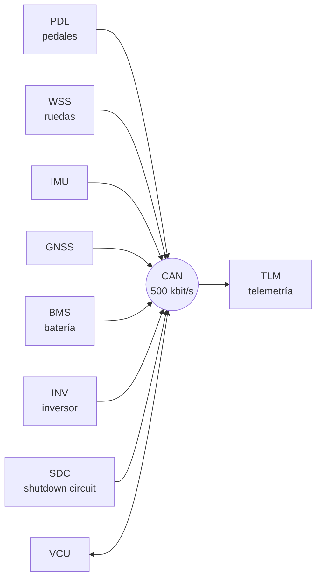

# 🚌 El bus CAN del coche simulado

[← Volver al README](../README.md)

Diseñé un DBC propio para el simulador: **11 mensajes, 117 señales**, 500 kbit/s, CAN 2.0A (IDs de 11 bits) y ~720 tramas/s.
Los IDs están ordenados por prioridad: cuanto más crítico el mensaje, más bajo el ID.

## Nodos



## Mensajes

| ID | Mensaje | Emisor | Periodo | E2E | Contenido |
|---|---|---|---|---|---|
| `0x010` | SDC_Status | SDC | 20 ms | ✔ | Estado de AMS, IMD, BSPD y aislamiento |
| `0x050` | VCU_Status | VCU | 10 ms | ✔ | Estado, modo, par pedido y límite, flags de plausibilidad |
| `0x060` | PDL_Pedals | PDL | 10 ms | ✔ | APPS1, APPS2, freno delantero y trasero |
| `0x0A0` | INV_Status | INV | 10 ms | ✔ | rpm, par real, corriente DC |
| `0x0A1` | INV_Temps | INV | 100 ms | | Temperaturas de motor e inversor, tensión DC |
| `0x0B0` | BMS_Pack | BMS | 20 ms | ✔ | Tensión, corriente y SoC |
| `0x0B1` | BMS_Cells | BMS | 100 ms | | Tensión y temperatura mín./máx. de celda |
| `0x0B2` | BMS_CellTemps | BMS | 100 ms/bloque | | 48 sensores, **multiplexado** en 8 bloques |
| `0x0C0` | WSS_Speeds | WSS | 10 ms | ✔ | Velocidad de las 4 ruedas |
| `0x0D0` | IMU_Data | IMU | 10 ms | contador | Aceleraciones y yaw, en **Motorola (big endian)** |
| `0x300` | GNSS_Position | GNSS | 50 ms | | Posición, rumbo y odómetro |

Detalles a propósito para practicar: un mensaje **multiplexado** (`0x0B2`), uno en **big endian** (`0x0D0`),
señales **con signo** (par, corriente) y señales que **no ocupan bytes completos** (12 bits).

## Extracto del DBC

```dbc
BO_ 96 PDL_Pedals: 8 PDL
 SG_ PDL_APPS1 : 0|12@1+ (0.025,0) [0|102.375] "%" VCU,TLM
 SG_ PDL_APPS2 : 12|12@1+ (0.025,0) [0|102.375] "%" VCU,TLM
 SG_ PDL_BrakeFront : 24|12@1+ (0.05,0) [0|200] "bar" VCU,TLM
 SG_ PDL_BrakeRear : 36|12@1+ (0.05,0) [0|200] "bar" VCU,TLM
 SG_ PDL_Counter : 48|4@1+ (1,0) [0|15] "" VCU,TLM
 SG_ PDL_CRC : 56|8@1+ (1,0) [0|255] "" VCU,TLM

BO_ 160 INV_Status: 8 INV
 SG_ INV_MotorSpeed : 0|16@1- (1,0) [-10000|10000] "rpm" VCU,TLM
 SG_ INV_TorqueActual : 16|16@1- (0.1,0) [-250|250] "Nm" VCU,TLM
 SG_ INV_DCCurrent : 32|16@1- (0.1,0) [-500|500] "A" VCU,TLM

BO_ 208 IMU_Data: 8 IMU
 SG_ IMU_AccelX : 7|16@0- (0.01,0) [-50|50] "m/s2" VCU,TLM
```

## Mapa de bits de `PDL_Pedals` (0x060)

| Bits | 0–11 | 12–23 | 24–35 | 36–47 | 48–51 | 52–55 | 56–63 |
|---|---|---|---|---|---|---|---|
| **Señal** | APPS1 | APPS2 | Freno delantero | Freno trasero | Contador | — | CRC-8 |
| **Escala** | 0,025 %/bit | 0,025 %/bit | 0,05 bar/bit | 0,05 bar/bit | 0…15 | | J1850 |

Cuatro señales de 12 bits caben en 6 bytes; el byte 6 lleva el contador y el byte 7 el CRC.

## Decodificación a mano

Con las señales reales del DBC (comprobado después con la librería cantools):

```text
① Velocidad de rueda   0x0C0  WSS_FL : 0|12@1+ (0.05,0) "km/h"         bytes: E8 03 00 ...
   Intel: el byte 0 es el menos significativo → 12 bits = 0x3E8 = 1000
   físico = 1000 × 0,05 + 0 = 50,0 km/h

② Temperatura motor    0x0A1  INV_MotorTemp : 0|16@1+ (0.1,-40) "degC"  bytes: 1A 04 ...
   raw = 0x041A = 1050
   físico = 1050 × 0,1 − 40 = 65,0 °C       (el offset −40 permite temperaturas bajo cero sin signo)

③ Par real del motor   0x0A0  INV_TorqueActual : 16|16@1- (0.1,0) "Nm"  bytes: .. .. 83 FF ..
   empieza en el bit 16 = byte 2 → raw = 0xFF83 = 65411
   con signo (complemento a dos): 65411 − 65536 = −125
   físico = −125 × 0,1 = −12,5 Nm            (negativo = frenada regenerativa)
```

**Comprobación de cordura** antes de fiarse de un DBC nuevo:
- ¿El valor está dentro de su rango `[mín|máx]`?
- ¿Cuadran las señales relacionadas? (velocidad de rueda ↔ rpm del motor; par negativo ↔ corriente negativa).
- ¿Hay un valor absurdo con el coche parado? Suele indicar endianness o signo mal definidos.
- Cambiar algo conocido (pisar el pedal) y ver **qué bits se mueven** en el sniffer.

## Lo que comprueba el validador de DBC

| Comprobación | Por qué importa |
|---|---|
| Solapes de bits (Intel y Motorola, con multiplexación) | Dos señales en los mismos bits se corrompen entre sí |
| IDs duplicados | Dos mensajes distintos que el receptor no puede distinguir |
| Rango no representable | El `[mín|máx]` declarado no cabe en los bits con ese factor y offset |
| Señal fuera del mensaje | Bits más allá del DLC |
| Mensaje sin emisor | Nadie es responsable de enviarlo |
| Contador sin CRC, ciclo o comentario ausente | Avisos de calidad |
