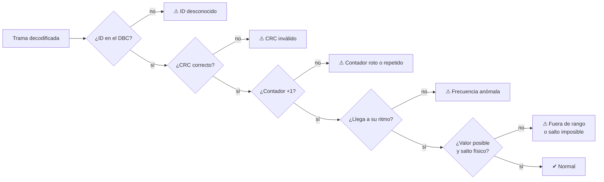
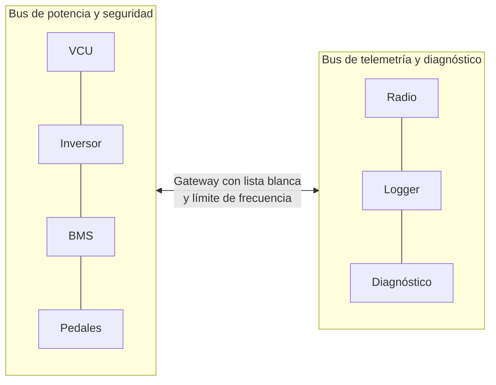

# 🔐 Ciberseguridad CAN

[← Volver al README](../README.md)

> Laboratorio **defensivo y educativo**. Los ataques se generan como tráfico **etiquetado** dentro de un bus **virtual en memoria**,
> sin hardware y sin conexión a ningún vehículo, para poder medir si el IDS los detecta.

## El problema de fondo

CAN se diseñó en los años 80 para ser **fiable**, no seguro:

| Propiedad | CAN clásico | Consecuencia |
|---|---|---|
| Autenticación del emisor | ❌ | Cualquier nodo puede enviar cualquier ID |
| Confidencialidad | ❌ | Todo viaja en claro |
| Integridad | ⚠ CRC-15 | Detecta errores de transmisión, no manipulación |
| Frescura (anti-replay) | ❌ | Una trama grabada es válida para siempre |
| Disponibilidad | ⚠ arbitraje | Un nodo que envíe IDs bajos puede acaparar el bus |

**Honestidad:** en un coche de competición universitaria el riesgo real es **bajo** (sin conexión remota y con acceso físico controlado).
Este módulo sirve para aprender y aplicar buenas prácticas.

## Modelo del atacante

Se asume alguien **con acceso al bus**, no alguien que rompe criptografía: un conector de diagnóstico accesible, un nodo comprometido
(por ejemplo un enlace de telemetría) o una herramienta de terceros con código no revisado.
Puede leer todo el tráfico, enviar tramas con cualquier ID y grabar y reenviar.

## Escenarios simulados y detectores

| Escenario | Qué hace | Detectores que lo marcan |
|---|---|---|
| **Suplantación de pedal** | Tramas de pedales falsas con el acelerador al 100 % | Frecuencia (dos emisores), contador |
| **Falsear el SoC** | Estado de carga falso para ocultar una batería baja | Frecuencia, contador, salto imposible |
| **Flooding / DoS** | Inunda el bus con el ID de máxima prioridad | ID desconocido, frecuencia |
| **Replay** | Reenvía tramas legítimas grabadas | Contador repetido, frecuencia |
| **Fuzzing** | Valores extremos o aleatorios | Salto imposible, frecuencia, contador |

Las comprobaciones son independientes: una misma trama puede disparar varias.

| Detector | Propiedad del bus sano | Falso positivo típico y cómo se evita |
|---|---|---|
| Frecuencia | Cada mensaje llega a su ciclo | Mensajes multiplexados: el ciclo por ID se divide entre los bloques |
| Rango / salto | Valores dentro del rango y con inercia física | Señales cuantizadas: se tolera la resolución; solo se vigilan señales con inercia |
| Contador | Avanza exactamente +1 | Una trama perdida de verdad: solo aviso, no crítico |
| CRC | Coincide con ID + datos | — |
| ID desconocido | El ID existe en el DBC | Herramientas de diagnóstico legítimas (lista blanca) |

## Cómo se mide

Como los ataques están **etiquetados** con su ventana de tiempo, cada detección se clasifica como verdadero o falso positivo:

| Métrica | Resultado (datos sintéticos) |
|---|---|
| Falsos positivos | **0 en 860 972 tramas**: conducción limpia en 4 pruebas (incluidos 10 min de resistencia) y 40 s con cada uno de los 10 fallos de seguridad funcional |
| Escenarios detectados | **5 de 5**, con precisión y recall del 100 % en los tests |
| Tiempo de detección | Desde la primera trama ofensiva (la detección es por trama) |

Sobre un **log importado** no hay etiquetas: lo que marca el IDS son **anomalías a revisar**, no aciertos ni falsos positivos.

## Límites (y cómo se evade un IDS)

- Un atacante que copie el contador, respete la cadencia y mande valores plausibles **evade los cinco detectores**. Un IDS **detecta, no previene**.
- **Supresión (bus-off):** forzar errores para silenciar un nodo legítimo y suplantarlo. El IDS solo vería un timeout.
- **Ventana de aprendizaje:** el IDS no emite detecciones durante los primeros segundos tras un reinicio (el laboratorio no deja lanzar ataques en esa ventana).
- Los umbrales están calibrados sobre el simulador; con un coche real habría que medirlos con datos reales.

## Mitigaciones

1. **Hardware de seguridad independiente del CAN:** ninguna trama puede cerrar el shutdown circuit.
2. **Segmentación de buses** y **gateway con filtrado** (lista blanca de IDs y límite de frecuencia por ID).
3. **Autenticación de los mensajes críticos (SecOC):** MAC truncado de 24 bits + contador de frescura.
   - Acertar un MAC: probabilidad 2⁻²⁴ por intento; cada rechazo se cuenta y dispara una alarma.
   - Tras un reinicio hay que **resincronizar la frescura**.
   - En un microcontrolador: **AES-CMAC** con acelerador hardware y claves en memoria protegida, nunca en el repositorio.
4. **Acceso físico protegido**, arranque seguro y firmware firmado.
5. **Grabar el bus** en cada salida: base para el análisis forense y las pruebas de regresión.

## Para profundizar

- AUTOSAR: *Specification of Secure Onboard Communication* y *E2E Protocol Library*.
- ISO/SAE 21434 y UNECE R155/R156 (marco de ciberseguridad en automoción de serie).
- C. Miller y C. Valasek, *Remote Exploitation of an Unaltered Passenger Vehicle* (2015).
