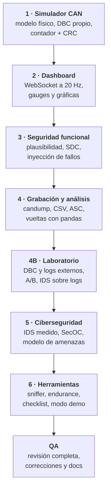

# 🛠️ Cómo lo desarrollé

[← Volver al README](../README.md)

## Objetivo

Aprender cómo funciona el software de un coche eléctrico de competición construyendo algo que funcione de principio a fin:
del sensor simulado a la trama CAN, de la trama al dashboard, y del dashboard al análisis y a la seguridad.

**Restricciones que me puse:**
- Todo en **local y sin internet** (pensado para un circuito sin cobertura y para no enviar datos a terceros).
- **Un solo comando** para arrancar, en Windows, Linux y macOS.
- Código con **tipos, docstrings y tests**.
- **Recortar extras antes que calidad.**

## Fases

Cada fase seguía el mismo ciclo:

## Decisiones de diseño (y por qué)

| Decisión | Por qué |
|---|---|
| **Python + FastAPI** | python-can, cantools y pandas son el estándar para CAN y datos en Python; FastAPI da REST y WebSocket con tipado |
| **JavaScript sin framework ni compilación** | Se clona y se ejecuta; uPlot dibuja miles de puntos con fluidez |
| **Sin CDN** | Funciona sin cobertura y no filtra datos a terceros |
| **Bus virtual de python-can, no `vcan`** | `vcan` (SocketCAN) solo existe en Linux; el bus virtual funciona igual en los tres sistemas |
| **Todo pasa por el bus** | El IDS y las pruebas ven lo mismo que un nodo real |
| **Un único modelo físico** | Las comprobaciones cruzadas (rpm ↔ velocidad de rueda) tienen sentido |
| **Reloj de simulación con pasos enteros** | Determinista, sin deriva de coma flotante; los tests corren más rápido que el tiempo real |
| **Plausibilidad como código puro** | La misma lógica en la VCU simulada y en el monitor independiente; portable a C |
| **Formatos estándar de log** | Un log del simulador y uno real son intercambiables |
| **Importar = convertir a sesión estándar** | Un solo camino de código para reproducir, exportar y analizar |
| **IDS con reglas, sin machine learning** | Cada alerta se puede explicar y verificar |

## Pruebas y calidad

| Nivel | Qué | Cifra |
|---|---|---|
| Unitarias y de integración | Decodificación DBC, E2E, simulador, plausibilidad con su temporización exacta, fallos, grabación, análisis, IDS, SecOC, cada parser de log con ficheros de prueba propios, API | **195 tests** con pytest |
| Navegador (E2E) | Playwright pulsa **todos los controles** de las 6 pestañas, también en orden raro (doble clic, recargar durante una reproducción, cambiar de pestaña a mitad de una importación) y falla ante cualquier error de consola o del servidor | **7 tests** |
| Cobertura | Backend completo | **92 %** (100 % en plausibilidad, monitor e IDS) |
| Rendimiento | Importar un log de 93 MB | 2 millones de tramas en ~56 s, con memoria constante |
| Sin pérdidas | Exportar a candump/ASC y volver a importar | Mismas tramas, error de tiempo ≤ 1 µs |
| IDS | Tráfico limpio y con fallos de seguridad funcional | 0 falsos positivos en 860 972 tramas |

### La revisión de QA final

Al terminar hice una revisión completa, como si el software fuera de otra persona:

1. **Inventario** de todas las pestañas, botones, endpoints (53) y el WebSocket.
2. **Pruebas por apartado** contra un servidor aislado: 133 comprobaciones automáticas, más el modo demo completo y sus interrupciones.
3. **Interconexión**: que un fallo inyectado llegue a la alerta, al historial y al informe; que un DBC externo se use en el dashboard y en el IDS; etc.
4. **Informe** con 17 hallazgos clasificados por severidad: 0 críticos, 11 corregidos y vueltos a probar (la mayoría con un test de regresión) y 6 menores documentados.

Algunos ejemplos de lo que encontré:

| Hallazgo | Lección |
|---|---|
| Un ataque lanzado durante el aprendizaje del IDS no se detectaba y bajaba el recall sin explicación | Una métrica sin contexto engaña: ahora la interfaz lo impide y lo explica |
| Un fichero BLF truncado se importaba sin aviso | Las librerías pueden fallar en silencio; hay que comprobar lo que dicen las cabeceras |
| Doble clic en «Importar» creaba dos sesiones idénticas | Las acciones deben ser idempotentes en el servidor, no solo en el botón |
| El checklist marcaba «circuito de seguridad abierto» al reproducir un log que simplemente no tenía esa señal | «Sin datos» no es lo mismo que «fallo» |
| Una cifra de la documentación no se podía reproducir | Toda cifra pública debe salir de un script que cualquiera pueda ejecutar |

## Desarrollo asistido por IA

Usé **herramientas de IA** como asistente durante todo el proyecto: para generar y revisar código, proponer tests, encontrar errores y redactar documentación.
Mi trabajo fue definir qué construir y en qué orden, tomar las decisiones de diseño, **ejecutar y verificar** cada fase,
y no dar nada por bueno sin probarlo. Fue una forma muy rápida de aprender, pero obliga a entender cada pieza para poder comprobarla.

## Cómo se llevaría a una ECU real

| Prototipo (Python) | Sistema real |
|---|---|
| Hilo que lee el bus virtual | Interrupción del periférico CAN (bxCAN/FDCAN en STM32) con filtros hardware por ID |
| Reloj simulado a 500 Hz | Timers de hardware y tareas de un RTOS con prioridades |
| python-can | Driver CAN con lectura de contadores de error para detectar bus-off |
| Plausibilidad en Python | La misma máquina de estados en C/C++ sin memoria dinámica, probada en el host y en banco |
| HMAC-SHA256 en software | AES-CMAC acelerado por hardware |
| Pruebas con el bus virtual | Hardware-in-the-loop: la ECU real conectada a este simulador mediante un adaptador CAN |

## Hoja de ruta

- [ ] Validar con datos reales y recalibrar umbrales e IDS.
- [ ] Portar la plausibilidad y el IDS a C para un microcontrolador.
- [ ] Decodificar CAN FD y usar MAC más largos.
- [ ] Detectar bus-off y supresión de nodos en el IDS.
- [ ] Resincronización de la frescura de SecOC tras reinicios.
