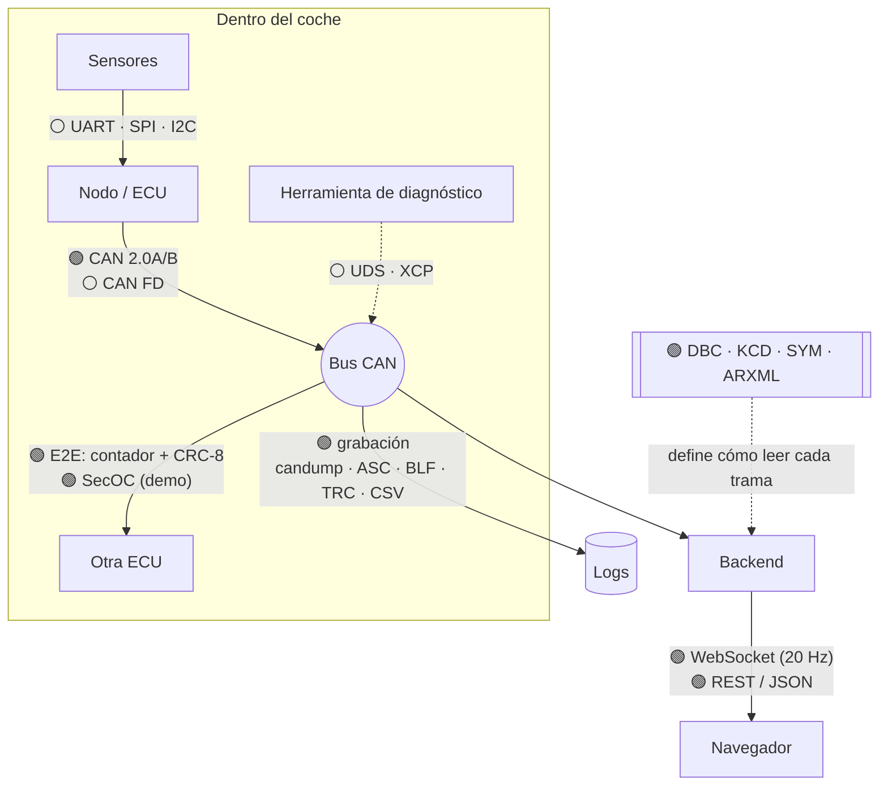
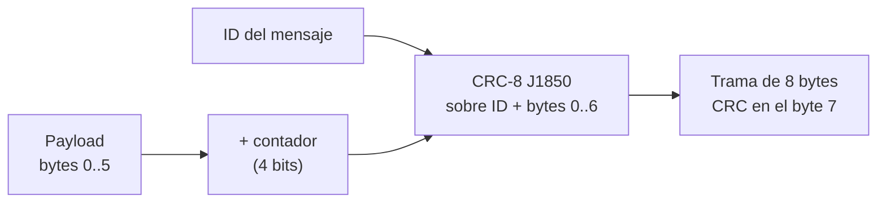

# 🔌 Protocolos y formatos

[← Volver al README](../README.md)

Leyenda: 🟢 **se usa en el proyecto** · ⚪ **solo contexto** (para entender el ecosistema)

## Mapa general



## 🟢 CAN (Controller Area Network)

Bus serie de dos hilos donde **todos los nodos oyen todo**. Un mensaje no lleva destinatario: lleva un **ID** que dice *qué* es.

```
┌─────┬──────────────┬─────┬──────────────────────────┬────────┬─────┬─────┐
│ SOF │ ID (11 / 29) │ ... │ DLC │ Datos (0–8 bytes)  │ CRC-15 │ ACK │ EOF │
└─────┴──────────────┴─────┴──────────────────────────┴────────┴─────┴─────┘
```

| Concepto | En pocas palabras | En el proyecto |
|---|---|---|
| **Arbitraje** | Si dos nodos hablan a la vez, gana el ID más bajo sin destruir su trama | Los mensajes críticos tienen IDs bajos |
| **Bitrate** | 500 kbit/s o 1 Mbit/s son habituales | 500 kbit/s, ~18 % de carga calculada con bit stuffing |
| **IDs estándar / extendidos** | 11 bits (CAN 2.0A) / 29 bits (CAN 2.0B) | El simulador usa 11; el Laboratorio importa ambos |
| **Terminación** | 120 Ω en cada extremo del bus | ⚪ Hardware, no aplica a un bus virtual |
| **Bus-off** | Un nodo con demasiados errores se desconecta solo | ⚪ Documentado como amenaza (supresión de un nodo) |

⚪ **CAN FD:** hasta 64 bytes por trama y fase de datos más rápida. El Laboratorio **detecta y cuenta** estas tramas en un log, pero no las decodifica.

## 🟢 DBC: el contrato del bus

Fichero de texto que describe cada mensaje: qué señales lleva, en qué bits, con qué escala, unidad y rango.

```
BO_ 161 INV_Temps: 8 INV
 SG_ INV_MotorTemp : 0|16@1+ (0.1,-40) [-40|200] "degC" VCU,TLM
       │              │  │ │ │   │     └ rango físico   └ unidad
       │              │  │ │ │   └ factor, offset
       │              │  │ │ └ + sin signo / - con signo
       │              │  │ └ @1 Intel (little endian) / @0 Motorola (big endian)
       │              │  └ longitud en bits
       │              └ bit de inicio
       └ nombre de la señal
```

**Valor físico = raw × factor + offset.** Ejemplos resueltos a mano en [bus-can.md](bus-can.md).

El proyecto también lee **KCD, SYM y ARXML** (otros formatos de base de datos CAN) gracias a la librería cantools.

## 🟢 Protección E2E: rolling counter + CRC

| Pieza | Qué detecta | Qué NO detecta |
|---|---|---|
| **Rolling counter** (4 bits, 0…15) | Tramas perdidas, repetidas o congeladas | Una trama fabricada con el contador correcto |
| **CRC-8 SAE J1850** sobre `[ID, datos]` | Corrupción dentro de la ECU o del gateway; un payload copiado bajo otro ID | Manipulación intencionada: **no tiene secreto** |



> Un CRC detecta **errores**, no **ataques**: cualquiera que conozca el DBC puede recalcularlo. Por eso existe SecOC.

## 🟢 SecOC (demo simplificada)

Idea de AUTOSAR *Secure Onboard Communication*: añadir a la trama un **MAC** calculado con una clave secreta y un **contador de frescura**.

```
MAC   = truncar( HMAC-SHA256(clave, id ‖ payload ‖ frescura), 24 bits )
trama = [ 4 B payload | 1 B frescura | 3 B MAC ]
```

| Ataque | Por qué falla |
|---|---|
| Suplantación | Sin la clave, acertar un MAC de 24 bits tiene probabilidad 2⁻²⁴ por intento |
| Replay | La frescura solo avanza: un valor antiguo se rechaza |
| Mover un payload a otro ID | El MAC incluye el ID |

En un microcontrolador lo habitual sería **AES-CMAC** con aceleración por hardware. Más detalle en [ciberseguridad.md](ciberseguridad.md).

## 🟢 WebSocket y REST

| | REST / JSON | WebSocket |
|---|---|---|
| Patrón | El navegador pregunta, el servidor responde | Conexión abierta: el servidor **empuja** datos |
| Uso | Acciones (inyectar un fallo, importar un log, exportar) y consultas (análisis, sesiones) | Telemetría en directo a 20 Hz |
| Mensajes | Uno por acción | `hello` al conectar (catálogos, configuración) y `tick` cada 50 ms |

## 🟢 Formatos de log

| Formato | Origen | Tipo | Ejemplo / pista de detección |
|---|---|---|---|
| **candump** (`-l`, `-L`, consola) | can-utils (Linux) | Texto | `(1697040000.123456) can0 0A0#0000831F...` |
| **ASC** | Vector (CANalyzer / CANoe) | Texto | Cabecera `date ...` / `base hex` y líneas `Rx d 8 ...` |
| **BLF** | Vector | Binario comprimido | Cabecera mágica `LOGG` |
| **TRC** | PEAK-System (PCAN-View) | Texto | Cabecera `;$FILEVERSION` |
| **CSV** | Cualquier logger | Texto | Asistente de columnas: tiempo, ID, DLC, datos (o una columna por señal ya decodificada) |

La autodetección mira el **contenido**, no la extensión. Cada formato se convierte a la misma sesión interna, y se puede exportar de vuelta a candump o ASC sin pérdidas
(probado con ida y vuelta: mismas tramas, error de tiempo ≤ 1 µs).

## ⚪ Otros protocolos del ecosistema

| Protocolo | Qué es | Dónde aparece |
|---|---|---|
| **LIN** | Bus lento y barato de un hilo | Elevalunas, espejos |
| **J1939** | Capa de aplicación sobre CAN con IDs de 29 bits | Vehículos pesados; algunos inversores y BMS |
| **UDS** | Diagnóstico: leer errores, flashear ECUs | Talleres, bootloaders |
| **XCP** | Medida y calibración de una ECU en marcha | Ajuste de mapas y parámetros |
| **UART / SPI / I2C** | Buses dentro de una placa | Entre el microcontrolador y sus sensores |
| **Ethernet automotriz** | Ethernet de alta velocidad para el vehículo | Cámaras, sistemas de asistencia |
