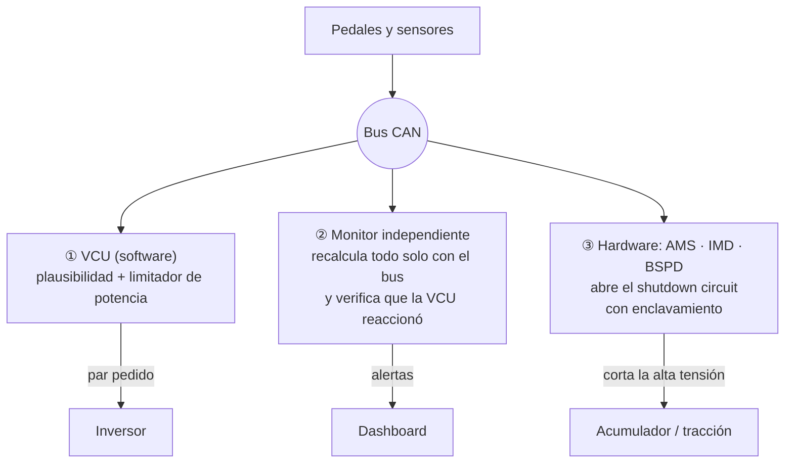
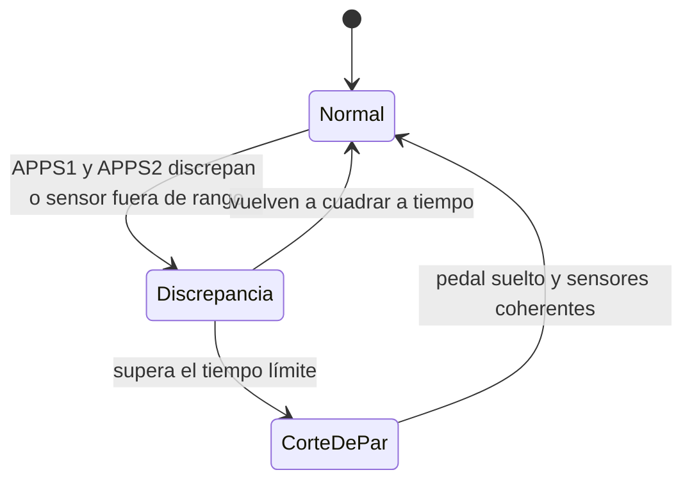

# 🛡️ Seguridad funcional (simulada)

[← Volver al README](../README.md)

> [!WARNING]
> Todos los umbrales del proyecto están en un fichero de configuración y son **orientativos**. No son una cita del reglamento
> de ninguna competición: antes de usarlos en un sistema real hay que verificarlos con el **reglamento oficial vigente** y con los requisitos del propio vehículo.

## Defensa en profundidad

Si una capa falla, la siguiente actúa. Ejemplo que el simulador reproduce: un **bug en la VCU** hace que no corte el par al pisar freno y acelerador.
El monitor lo detecta y avisa, y el **BSPD** (hardware) abre el shutdown circuit, que queda enclavado hasta un rearme manual.

## Conceptos

| Concepto | Qué es | Cómo lo simula el proyecto |
|---|---|---|
| **APPS1 / APPS2** | Dos sensores independientes del acelerador | Si discrepan más de un umbral durante más de un tiempo, o salen de rango, corte de par |
| **Freno + acelerador** | Pisar ambos con el acelerador por encima de un umbral | Corte enclavado hasta soltar el acelerador |
| **Limitador de potencia** | Potencia máxima extraída del acumulador | La VCU recorta el par; el monitor mide la media móvil y alerta si se supera |
| **Shutdown circuit (SDC)** | Lazo en serie que desconecta la alta tensión | Lo abren AMS, IMD o BSPD; solo se cierra con un rearme manual sin la causa presente |
| **AMS** | Vigilancia de tensión y temperatura de celdas | Celda fuera de rango → abre el SDC |
| **IMD** | Vigilancia del aislamiento alta tensión ↔ chasis | Aislamiento bajo → abre el SDC |
| **BSPD** | Frenada fuerte + potencia a la vez durante un tiempo | Abre el SDC aunque el software falle |
| **Estado seguro** | Ante la duda, sin par | Si falta un mensaje, salta el timeout y la alerta |

## Plausibilidad como máquina de estados

La lógica es **código puro dirigido por marcas de tiempo**: no depende de relojes del sistema ni de hilos.
El mismo código lo usa la VCU simulada (a 500 Hz, con el reloj de simulación) y el monitor (a 100 Hz, con las marcas de tiempo de las tramas).
Eso lo hace determinista, fácil de probar y portable a C en un microcontrolador.

## Inyección de fallos

Cada fallo documenta la **reacción esperada**, y hay tests que comprueban que ocurre:

| Fallo | Reacción esperada |
|---|---|
| Deriva del sensor APPS2 | Implausibilidad → corte de par; el par vuelve al soltar el pedal |
| APPS1 en cortocircuito | Señal fuera de rango → corte mientras dure |
| Pisar freno y acelerador | Corte inmediato, enclavado hasta soltar el acelerador |
| Bug en el software de la VCU | El monitor detecta que la VCU no reacciona |
| Fallo de refrigeración de la batería | Aviso, crítico y apertura del SDC por el AMS |
| Fallo de la bomba de refrigeración | Motor e inversor se calientan → alertas |
| Celda degradada | Tensión mínima de celda baja → alertas y AMS |
| Limitador de potencia desactivado | El monitor mide la potencia por encima del límite y alerta |
| Pérdida de aislamiento | El IMD abre el SDC |
| Pérdida de un mensaje | Timeout del mensaje; el resto del bus sigue funcionando |

## Configuración con validación

Los umbrales se leen de un fichero YAML que se **valida al cargarlo**: claves desconocidas, tipos y coherencia entre aviso y crítico.
Se puede recargar en caliente; si el fichero nuevo es inválido, se mantienen los anteriores y se explica el error. Así una errata no desactiva una comprobación en silencio.
